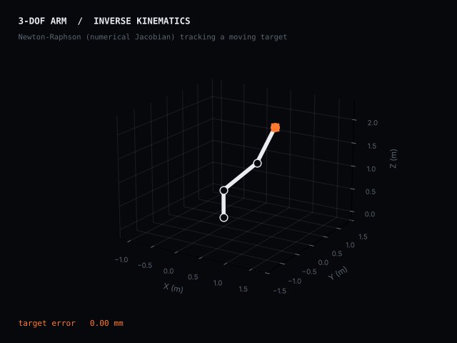

<div align="center">



**Forward and inverse kinematics for robot arms of 1 to 6 degrees of freedom, with 3D animation and a reinforcement-learning experiment.**


</div>

---

<div align="center">



<sub>Animation rendered with the notebook's own <code>RobotArm</code> class (inverse kinematics solved with the numerical Jacobian).</sub>

</div>

---

## ✨ What it does

A single `RobotArm` class that you configure with a DOF count, link lengths, DH parameters and joint limits, then solve in several ways.

### Forward kinematics: joint angles → end-effector pose

| Method | Use it for |
|---|---|
| **DH parameters** | General serial arms, using Denavit-Hartenberg transforms |
| **Direct method** | Transform chains built straight from link geometry |
| **Planar (2D)** | Quick planar arms, with the position after every joint printed |

### Inverse kinematics: target position → joint angles

| Method | Use it for |
|---|---|
| **Newton-Raphson with DH** | Any DOF, iterating from an initial guess with a selectable analytical or numerical Jacobian (the numerical option is the reliable one; the analytical Jacobian is currently buggy) |
| **Geometric** | 2R and 3R planar arms, with an elbow-up or elbow-down choice |
| **Algebraic** | 2R and 3R arms |

### Visualisation

- 3D plots of the arm and animated motion between a start and an end pose
- An `ipywidgets` panel with a DOF slider and text fields for link lengths, angles and target, plus Forward and Inverse buttons
- A built-in test mode that checks the solvers

### 🤖 Learning experiment

The last section of the notebook wraps the arm in a custom **Gym environment** and trains a **PPO** agent (Stable-Baselines3) to reach a target position, then animates the result.

---

## 🚀 Run it

The notebook is built for Google Colab, so upload `kinematics_calculator.ipynb` there and run the cells in order. To run locally:

```bash
git clone https://github.com/aryankhanna1409/kinematics-calculator.git
cd kinematics-calculator

pip install numpy matplotlib ipywidgets jupyter
# only for the learning section:
pip install gym stable-baselines3 torch "shimmy>=2.0"

jupyter notebook kinematics_calculator.ipynb
```

Animations are rendered to video with `ffmpeg`, so install it first (`apt-get install ffmpeg` on Ubuntu or Colab).

The interactive simulator asks for a mode (`F` forward, `I` inverse or `T` test), then the DOF count and method, then your parameters.

---

## 📁 Files

| File | What it is |
|---|---|
| `kinematics_calculator.ipynb` | The calculator, animations, widget interface and RL experiment, with saved example outputs |

---

<div align="center">

Built while learning robot kinematics

</div>
